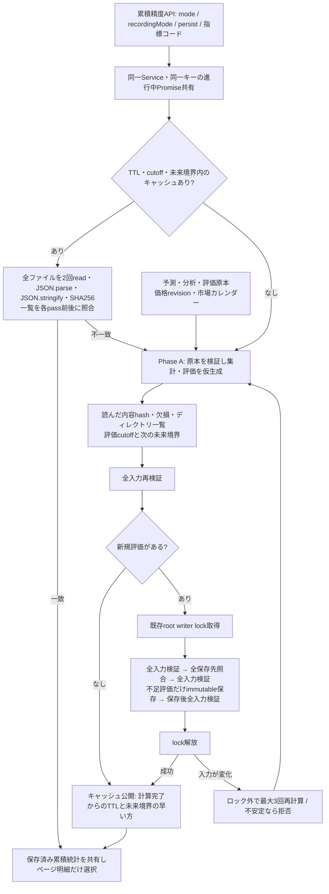
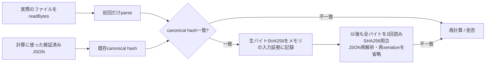

# 予測精度4.0: 厳密な変更検出を保った高速化

## 起点と調査

起点main / origin/main: `246972329590767e49ca6631361d6757e8edab33`。開始時の未コミット差分なし。実利用者data・秘密情報・環境ファイルを読まず、人工fixtureだけを使用する。J-Quants追加取得、MemWal同期、Sui操作は行わない。

調査対象は `scout-accuracy-cache.ts` / `scout-accuracy-io.ts` / `bottom-scout-accuracy.ts` / `bottom-scout-journal.ts` / `packages/storage/index.ts` と既存ベンチマーク・二段階保存テスト。既存の[二段階保存](scout-writer-lock-remediation.md)は維持する。

### 変更前の依存関係



ページ番号と分析IDフィルターは累積キャッシュキーに入れず、ページ明細だけを変える。異なる区分・保存可否・cutoff・未来期限は混同しない。予測ID・評価IDの既存canonical JSON hashは変更しない。

## Phase Aの設計

### 生バイトの証拠と原本hashの結び付け

従来は再表示のたび、同じJSONをparseして再serializeし、内容hashを作っていた。原本の意味内容を初回に検証した後は、生バイトのSHA-256を使って再確認する。

1. 計算で実際に読んだJSONの既存hashを記録する。
2. ファイルを生バイトで読み、**そのバイトをparseした既存hashが計算入力と同じ**ことを確認してから、生バイトのSHA-256を結び付ける。
3. 同じ検証の2pass目、保存前後、再表示時も全ファイルを実際に読み、生バイトのSHA-256を照合する。mtime・サイズ・世代番号でreadを省略しない。
4. 読取中に変わった場合は2pass目または一覧照合で検出し、再計算または拒否する。生バイトが変われば、空白だけの変更でもキャッシュを無効にして再計算する。

ここで結び付けるJSON hashは、計算がStore.readで受け取ったJSON全体のhashである。forecastId・evaluationId等に定義された「ID自身を除いたbodyのhash」は、従来の原本検証で別途確認し、定義を変更しない。



Store.readBytesはStore.readと同じパス検証・プロセス内共通32 read上限を使う。従来のJSON読取も同じバイトをUTF-8へ変換する。保存・暗号化・原本スキーマ・writer lockは変えない。

ディレクトリ一覧は並びを整え、文字列配列の完全一致で照合する。JSON化してhashを比較する必要はない。計算中のmemo化済みJSONについて、同じファイルを再参照するたびのhash・未来日付探索も重複実行しない。fallbackは呼び出しごとに扱う。

scout専用I/O helperは従来と同じ最大16処理を維持し、終了したworkerから次の入力を処理する。遅いディレクトリ木1件のために16件全体の終了を待つ方式を改める。結果順は入力順を維持し、エラー時は新規処理を止め、開始済み処理の完了を待ってから拒否する。

### 価格系列と計算の共有

- 全体の価格系列は既存のリクエスト内Promise共有を維持する。
- 検証済みforecast・report・固定カレンダーをjournalへ渡し、同じ原本の重複parse/hashを避ける。固定カレンダーの検証条件は共通helperへ抽出し、元のjournal呼び出しでも使用する。
- outcomeはリクエスト内だけで共有する。読込済み価格系列の配列identity、基準日、horizon、カレンダーhash、評価cutoff、日中安値の必要性を区別する。共有する系列・カレンダーと各要素をfreezeし、同じ配列を後から書き換えて古い数値を返すことを防ぐ。固定カレンダーは検証済みhashごとに同じsnapshotを使用する。
- 相場環境の計算は指標コード・基準日・取得cutoffごとにリクエスト内で共有する。評価時点の系列と予測時点の系列を混同しない。
- 数値計算式・順位・重複除外・methodVersionを変えない。結果はcloneし、呼び出し元の変更を共有しない。

## Phase B: 永続派生インデックスの検討

候補形式は `research/scout/accuracy-index/v1/` に、schemaVersion / algorithmVersion / mode / recordingMode / forecastId・evaluationId / canonical hash・byte hash / 入力一覧 / cutoff・until / 統計 / createdAt / 自己hashを保存する設計。

しかし自己hashは**インデックスファイル自身の整合性**しか確認しない。元ファイルの削除・追加・書換え、とくにStore.lockを使わない手動編集を証明できない。OSのmtime・サイズ・世代・通知を信用して全readを飛ばすことはしない。

| 方式 | 手動編集・別プロセス・再起動 | 表示の意味 | 採否 |
|---|---|---|---|
| 全入力・一覧を検証するメモリキャッシュ | 毎回内容を確認。再起動はキャッシュなしから原本検証 | 厳密検証結果 | 採用 |
| 永続indexの自己hashだけ照合 | 元ファイル変更を証明できない | 未検証snapshot | 不採用 |
| mtime/サイズ/世代/ファイル通知だけ | 同サイズ・同mtime編集、通知漏れ、外部編集、再起動を保証できない | 未検証snapshot | 不採用 |
| 永続index＋全入力のbyte hash・一覧検証 | 正しく実装すれば既存と同じ保証にできるが全readは残る。大きい集計payloadの読込・保存・競合・backup量も増える | 厳密検証結果 | 今回は導入しない |
| 検証を待たない高速表示モード | 未検証の変更があり得る | 検証状態・最終確認時刻・再検証状態のUI/API明示が必須 | 今回は導入しない |

自己hashを原本の証拠と誤認する永続indexや、未検証の成績を検証済みとして返すモードは追加しない。`accuracy-index/v1` の既存・壊れた・偽装ファイルは集計根拠として使用しない。永続indexの専用lockや移行も不要となる。

なお現行Store.generationの追跡対象には `research/scout` 全体が含まれていない。追跡範囲を拡張しても手動編集を証明できないため、今回この世代をキャッシュ検証の代用にしていない。

## 保証範囲と限界

予測・評価の追加/削除/内容変更、評価revision追加、価格revision変更、市場カレンダー変更は、参照したファイルの全内容と一覧を毎回確認する。別Service・別プロセスの変更、同サイズ・同mtimeの編集も世代番号に頼らず確認する。プロセス再起動時はメモリ証拠を再利用せず、原本から作り直す。通知を使わないため取りこぼしや監視件数上限に依存しない。

暗号学的hashの衝突耐性を前提とする。通常のFS上の複数ファイルをatomic snapshotとして読む保証ではなく、検証の間だけ現れて完全に元へ戻された編集など、すべての瞬間の変更履歴を証明する仕組みでもない。これは従来の複数pass検証にもある限界。変更が継続した場合は最大3回で拒否し、古い結果を成功として返さない。

1秒未満のために全readを無条件に省略しない。件数・容量に比例するI/Oとディレクトリ確認のコストは残る。

## 実測・検証結果

### 条件と比較方法

Windows、Node v24.14.0、Intel Core i5-10400 2.90GHz、論理12CPU、RAM約31.7GiB。人工データは1分析10候補、250銘柄、日足2revision、重複する4基準日。独立な実運用予測の精度実証ではない。評価cutoffを固定し、同じ入力条件を比較した。

変更前は製品ソース変更前に起動した非watchのプロセス、変更後は `6e8b93a` の製品コードを別プロセスで起動して測定。各規模でアプリcoldから開始し、評価原本1件だけを不足させて保存した後、cacheとpage2を交互に各5回測定した。初回は高コストなため各1回。初回n=1をp50/p95のばらつき測定とは扱わない。hotのp95はnearest rankで、n=5では最大値となる。

Nodeは `--expose-gc --max-old-space-size=8192 --import tsx`。OSファイルキャッシュは消去していない。API関数の時間で、HTTPや画面描画は含まない。当方の回帰テストは性能測定と並行実行していないが、通常PC上の他作業・OS負荷は完全に制御していない。5,000件の変更前page2には48.94秒の外れ値があり、そのままp95へ含めた。初回の単発差やメモリ増分から一般的な性能保証を断定しない。

### API時間

単位は秒、矢印は変更前→変更後。

| 分析数 | 初回 n=1 | cache p50 | cache p95 | page2 p50 | page2 p95 |
|---:|---:|---:|---:|---:|---:|
| 100 | 11.543→7.530 | 1.930→0.673 | 1.998→0.701 | 1.989→0.691 | 2.096→0.713 |
| 1,000 | 43.554→17.784 | 5.221→2.074 | 5.502→2.278 | 5.142→2.115 | 5.259→2.247 |
| 5,000 | 178.965→66.664 | 19.783→7.993 | 25.992→8.043 | 19.432→7.975 | 48.942→8.240 |
| 10,000 | 440.198→124.270 | 38.890→15.405 | 45.902→15.792 | 39.544→15.493 | 41.487→15.702 |

**10,000分析の1秒未満は未達。** 実測cache p50は約60.4%短縮、約2.5倍の速さ。ただし全内容・一覧の検証コストは残る。100分析ではp95も1秒未満だが、この値を10,000分析へ外挿しない。

変更前44区間・変更後44区間が完走し、同じ規模・phase・runの**44組すべてでAPI応答hashが一致**した。予測原本や評価IDの変更によって数値を改善したものではない。

### 読み込み・JSON・hash

cache/page2は同じ全入力を読み、読込回数・バイト数は変更前後で一致した。`Store.read`呼出0回はディスクread0回の意味ではない。変更後はreadBytesを使う。以下はcache・page2それぞれ1回あたりの値。

| 分析数 | FS read回数 前=後 | 読取バイト 前=後 | 変更後の原本read回数 | JSON.parse 前→後 |
|---:|---:|---:|---:|---:|
| 100 | 1,102 | 143,453,972 | 600 | 1,102→0 |
| 1,000 | 6,502 | 271,146,422 | 6,000 | 6,502→0 |
| 5,000 | 30,502 | 838,668,422 | 30,000 | 30,502→0 |
| 10,000 | 60,502 | 1,548,070,922 | 60,000 | 60,502→0 |

原本read回数はforecast・report・evaluationの `/original.json` を読む回数（2pass合計）。残りは価格・カレンダー等。変更前は原本だけの内訳を個別計数していないため、原本限定の前後回数として推測値を記載しない。FS read総数・バイト数の一致を確認した。

10,000分析のcacheで、変更前のJSON.parse時間p50は5.812秒、JSON.stringify時間p50は4.736秒。変更後はJSON.parse 0回、JSON.stringify 4回・約0.00035秒で、キー・計測用writer・レスポンス等の少量だけが残る。これらの計測値はJSON処理時間であって、SHA本体の時間ではない。

SHA本体は大規模ベンチマーク終了後、人工100分析のcacheを別途1回profileした。NodeのcreateHash/update/digestだけを一時的にこの計測プロセス内でラップし、引数のJSON.serialize時間を除外した。1,103 hash呼出で合計330.26ms、API 624.49ms。profileは本表の反復測定とは別で、10,000分析や変更前のSHA単体時間は未測定。

### writer lock

既存の二段階保存・root lock・待機上限120秒を維持。計算中の最初のsource readとlock取得直後に、別Serviceから通常の協調的writerを開始した。単位は秒。lock保持はcallback内時間で取得・解除のFS処理を除く。

| 分析数 | 初回lock 前→後 | lock中writer待機 前→後 | 初回タイムアウト 前→後 |
|---:|---:|---:|---:|
| 100 | 5.795→2.291 | 5.804→2.301 | 0→0 |
| 1,000 | 16.641→6.413 | 16.657→6.418 | 0→0 |
| 5,000 | 57.765→24.646 | 57.781→24.667 | 0→0 |
| 10,000 | 121.419→48.912 | 120.014 timeout→48.932成功 | 1→0 |

計算中writer待機は変更後全規模で約2.5〜5.5ms。cache/page2は前後ともlock取得0回で、変更後の通常writer待機p95は最大約10.8ms。変更前48回のwriter probe中1回timeout、変更後48回中0回。初回は全規模とも新規評価1件だけをimmutable保存した。全原本を未評価にした大量同時保存や、他の長時間lock保有者まで120秒未満と保証する測定ではない。

### メモリ

GC後を基準にRSSを10ms間隔で観測。下表はpeak RSS**増分**MiBで、プロセス全体の最大使用量ではない。前→後、hotは5回のp50。

| 分析数 | 初回 n=1 | cache p50 | page2 p50 |
|---:|---:|---:|---:|
| 100 | 218.5→205.9 | 103.8→58.9 | 103.3→59.3 |
| 1,000 | 371.3→346.0 | 120.1→11.5 | 120.0→15.4 |
| 5,000 | 1,221.1→1,105.5 | 91.8→19.1 | 91.2→5.6 |
| 10,000 | 1,250.9→1,372.7 | 91.8→27.7 | 92.1→16.1 |

10,000分析の初回peak増分は増加しており、すべての条件でメモリ削減したとは言わない。同条件の終了時heap増分は約2,703.4→2,268.0MiB、cacheは約58.4→21.5MiB。RSS・heap・V8の領域再利用・GCに左右され、固定順の試験から削減率を一般化しない。全sampleのrssDelta / heapDelta / peakRssDeltaをJSONLに記録した。

未追跡ログ（生成データ・ログはコミットしない）:

- 変更前: `node_modules/.cache/scout-writer-lock-two-phase-1792447266634.jsonl`
- 変更後: `node_modules/.cache/scout-writer-lock-two-phase-1792449133317.jsonl`
- 集計: `node_modules/.cache/scout-v4-summary.json`
- SHA単体profile: `node_modules/.cache/scout-v4-sha-profile.json`

再実行は対象の製品コードを切り替えた安全なfixture環境で、以下のように呼ぶ（実環境設定は読み込まない）:

```powershell
rtk proxy node --expose-gc --max-old-space-size=8192 --import tsx scripts/benchmark-scout-writer-lock.ts 100,1000,5000,10000 - after 5
```

変更前の再現には `8cf044e` の計測スクリプトを使う（その時点の製品コードは起点2469723と同一）。末尾を `apps/api/src/bottom-scout-accuracy.ts before 5` にする。利用中のcheckoutを破壊的に切り替える必要はなく、保存済み実データを渡さずに独立したfixture環境で行う。

### 回帰テスト

今回の対象4ファイル41件は成功し、その後追加した予測・評価revision追加テストを含むv4の14件も成功した。最終の関連5ファイル45件も成功。

全件チェックは、前回の標準並列で既存研究テストがtimeoutし1 workerでは成功した経緯から、同じ時間制限・全件を `pnpm run test --maxWorkers=1` で実行する。テストの対象や時間制限を緩めていない。

初回全件実行は80ファイル280件中279件成功、1件失敗。`scout-scale-diagnostics` がエラー時の完了件数を固定バッチの16件と仮定していた。継続worker方式ではエラーを観測する前に完了workerが次の入力を始めることがあるため、正しい安全条件（同時数16以下・完了件数＝開始件数・active 0・拒否後の完了件数不変）を直接確認するテストへ更新した。失敗を放置せず、全件を再実行する。

全件再実行は80ファイル・280件すべて成功（402.36秒）。lint・typecheckも成功。buildは環境ファイルを読まない一時設定で既存buildスクリプトを実行し成功（Vite 761ms）。E2Eは36件すべて成功（1.9分）。専用5519/3019ポート・一時fixtureを使用し、外部通信は遮断した。SDKのmetadata取得警告は遮断に伴うもので、実Sui接続の成功を意味しない。最終チェックの失敗・タイムアウト・未実行はなし。標準並列の代わりに全件1 workerで実行した点と、初回の1件失敗を上記の通り区別する。

作業途中に別作業の `apps/api/src/earnings.ts` / `packages/core/earnings-analysis.ts` / `tests/earnings.test.ts` の未コミット差分が現れた。今回のコミットには含めず保護し、別作業で別コミットとなった。最終確認では作業ブランチが `codex/kabumaru-earnings-v1`、fetchしたorigin/mainが `14c2a9f27c735e35280a9a4e05dda46a1f715d61`。双方に別SHAの並行作業コミットがあるため、無断でcheckout・reset・rebase・mainへの統合は行わない。

## 今回の変更ファイルとコミット

- `apps/api/src/scout-accuracy-cache.ts`
- `apps/api/src/scout-accuracy-io.ts`
- `apps/api/src/bottom-scout-accuracy.ts`
- `apps/api/src/bottom-scout-journal.ts`
- `packages/storage/index.ts`
- `scripts/benchmark-scout-writer-lock.ts`
- `scripts/benchmark-scout-concurrency.ts`
- `tests/scout-accuracy-concurrency.test.ts`
- `tests/scout-accuracy-v4.test.ts`
- `tests/scout-scale-diagnostics.test.ts`
- `fixtures/scout-accuracy-process.ts`
- `docs/scout-accuracy-v4.md`

関連ファイルだけをコミットし、並行作業の企業材料機能は含めていない。

1. `8cf044e` test: establish scout accuracy performance baseline
2. `6e8b93a` perf: reduce redundant scout accuracy computation
3. `27b0134` test: cover scout accuracy source integrity
4. `51b6797` test: verify scout forecast and evaluation additions
5. `4129742` test: verify streaming accuracy read cleanup
6. 本文書: docs: record scout accuracy performance and safety results

永続indexを導入しないため、条件付きのindex機能コミットは作らず、テスト名もsource integrityとした。追加・改変・削除、同mtime編集、別プロセス、価格・カレンダー、評価revision、エラー後I/O完了、既存の二段階immutable保存を検証する。実サービス接続は未検証。今後は価格ファイルの重複容量・読取粒度と、明示的に未検証とする別表示モードの必要性を検討する。検証済み応答の全readを黙って省略しない。
